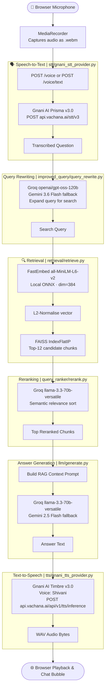

# Real-Time Voice RAG Agent

A **Real-Time Voice RAG Agent** that listens to a spoken question, retrieves relevant context from an uploaded document, generates a grounded answer, and responds in natural voice.

Pipeline: **STT (Gnani AI Prisma v3.0) → Local FastEmbed + FAISS RAG → Groq LLM (Gemini fallback) → TTS (Gnani AI Timbre v3.0)**

---

## Tech Stack

| Layer | Technology | Description |
| --- | --- | --- |
| **Backend API** | FastAPI + Uvicorn | High-performance asynchronous API server |
| **Speech-to-Text (STT)** | **Gnani AI Prisma v3.0** (`https://api.vachana.ai`) | Proprietary Indic/multilingual ASR foundation model |
| **LLM Reasoning** | **Groq** (`openai/gpt-oss-120b`) | Primary fast LLM (with Google Gemini fallback) |
| **Embeddings** | FastEmbed `all-MiniLM-L6-v2` (dim 384, ONNX) | Local, fast, low memory footprint |
| **Vector Store** | FAISS `IndexFlatIP` (L2 normalized) | Local in-memory index |
| **Text-to-Speech (TTS)** | **Gnani AI Timbre v3.0** (Voice: `Shivani`) | Natural neural speech synthesis |
| **Frontend** | Vanilla HTML / CSS / JS (dark theme) | Browser UI with mic recording and voice playback |

---

## Gnani AI Models & Research

This project uses foundational speech models from **Gnani.ai** hosted on the Vachana developer platform (`https://api.vachana.ai`):

1. **Speech-to-Text (ASR) — Prisma v3.0**:
   - Model: `prisma-v3.0`
   - Endpoint: `POST https://api.vachana.ai/stt/v3`
   - Features: Multilingual automatic language detection (`en-IN` / `indic-auto`), Inverse Text Normalization (ITN), and telephony/conversational speech recognition.
   - Header: `X-API-Key-ID: <GNANI_API_KEY>`

2. **Text-to-Speech (TTS) — Timbre v3.0**:
   - Model: `timbre-v3.0`
   - Endpoint: `POST https://api.vachana.ai/api/v1/tts/inference`
   - Features: Expressive neural voice synthesis across Indian languages and Indian-accented English, low latency audio streaming.
   - Default Voice: `Shivani` (`en-IN`)
   - Header: `X-API-Key-ID: <GNANI_API_KEY>`

---

## Architecture Flow



---

## Project Structure

```
RAG_AgenticVoice/
├── backend/
│   ├── app/
│   │   ├── main.py                  # FastAPI app and static file mounts
│   │   ├── config.py                # Environment configs and model constants
│   │   ├── embeddings.py            # Local FastEmbed (all-MiniLM-L6-v2)
│   │   ├── ingestion/
│   │   │   └── ingest.py            # PDF parser and FAISS builder
│   │   ├── improved_query/
│   │   │   └── query_rewrite.py     # Groq/Gemini query expansion
│   │   ├── query_ranker/
│   │   │   └── rerank.py            # Groq/Gemini semantic chunk reranker
│   │   ├── retrieval/
│   │   │   └── retrieve.py          # Vector search via FAISS
│   │   ├── llm/
│   │   │   ├── llm_provider.py      # Groq primary + Gemini fallback handler
│   │   │   └── generate.py          # RAG response generator
│   │   ├── stt/
│   │   │   └── gnani_stt_provider.py# Gnani AI Prisma v3.0 STT
│   │   ├── tts/
│   │   │   └── gnani_tts_provider.py# Gnani AI Timbre v3.0 TTS
│   │   └── routes/
│   │       ├── voice.py             # POST /voice, POST /voice/text, POST /chat
│   │       └── ingest.py            # POST /ingest, POST /ingest/text, GET /api/document
│   ├── data/                        # Local PDF documents
│   └── .env                         # Local API credentials (gitignored)
├── frontend/
│   ├── index.html                   # Web interface
│   ├── style.css                    # Dark theme styles
│   └── script.js                    # Audio recording, playback, and chat interaction
├── requirements.txt                 # Python dependencies
├── pyproject.toml                   # Project metadata
└── README.md
```

---

## Setup Instructions

### 1. Create and Activate Virtual Environment

From the root project directory:

```bash
python -m venv venv
```

Activate the environment:
- **Windows (PowerShell)**:
  ```powershell
  .\venv\Scripts\Activate.ps1
  ```
- **Linux / macOS**:
  ```bash
  source venv/bin/activate
  ```

### 2. Install Dependencies

```bash
pip install -r requirements.txt
```

### 3. Configure Environment Variables

Create a `backend/.env` file:

```env
# ==============================================================================
# API Keys
# ==============================================================================
GROQ_API_KEY=your_groq_api_key_here
GNANI_API_KEY=your_gnani_api_key_here
GEMINI_API_KEY=your_gemini_api_key_here

# ==============================================================================
# LLM Models (Groq Primary, Google Gemini Fallback)
# ==============================================================================
GROQ_LLM_MODEL=llama-3.3-70b-versatile
GEMINI_LLM_MODEL=gemini-2.5-flash

# ==============================================================================
# Speech-to-Text (STT) — Gnani AI Prisma
# ==============================================================================
GNANI_STT_MODEL=prisma-v3.0
GNANI_STT_LANGUAGE_CODE=en-IN

# ==============================================================================
# Text-to-Speech (TTS) — Gnani AI Timbre
# ==============================================================================
GNANI_TTS_MODEL=timbre-v3.0
GNANI_TTS_VOICE=Shivani
GNANI_TTS_LANGUAGE=en-IN

# ==============================================================================
# Embedding Model (Local FastEmbed)
# ==============================================================================
EMBEDDING_MODEL=sentence-transformers/all-MiniLM-L6-v2
EMBEDDING_DIM=384

# ==============================================================================
# Gnani AI Base Endpoint
# ==============================================================================
GNANI_BASE_URL=https://api.vachana.ai
```

### 4. Run the Server

```bash
cd backend
uvicorn app.main:app --reload --port 8000
```

Open `http://localhost:8000` in your web browser. Upload a PDF or paste text, and begin voice or text chat.

---

## API Endpoints

- **`POST /chat`**: JSON endpoint `{ "message": "...", "tts": true }` returning `{ "question": "...", "answer": "...", "audio_base64": "...", "audio_mime": "..." }`.
- **`POST /voice`**: Multipart audio endpoint returning synthesized audio bytes directly with response text in headers.
- **`POST /voice/text`**: Audio transcription helper.
- **`POST /ingest`**: Dynamic PDF ingestion endpoint that indexes documents into FAISS in real time.
- **`GET /api/document`**: Status check for existing index.
